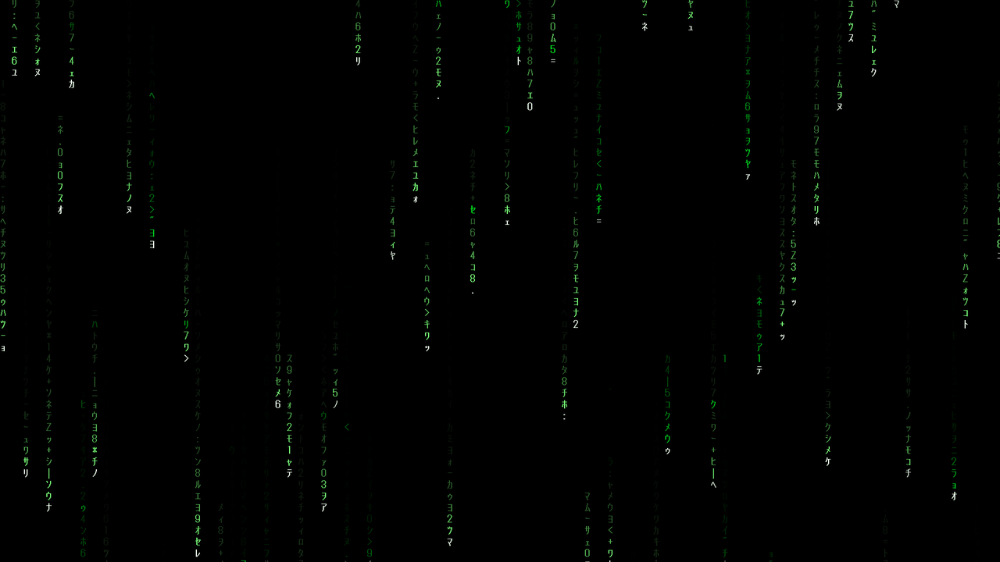

# Digital Rain screensaver

Green falling-character "code rain" screensaver for Windows 10 and 11.

**Created by aning with the help of Claude** (Anthropic's AI assistant).



- Columns of half-width katakana and digits falling at different speeds, with a bright leading character and fading green trails
- Runs on every monitor, at full resolution on scaled (e.g. 125%) displays
- Exits on mouse move, click or key press
- Works in the small preview of Screen Saver Settings
- Tiny (about 10 KB), no dependencies: uses the .NET Framework built into Windows

## Download and install

1. Download **`DigitalRain-1.0.0.zip`** from the [latest release](https://github.com/aningako/digital-rain-screensaver/releases/latest).
2. Extract the zip, then double-click **`Install.bat`**. It copies the screensaver to your user folder, sets it as your
   screensaver and opens Screen Saver Settings so you can preview it and choose the delay. No admin rights needed.

To remove it, run **`Uninstall.bat`**.

Manual alternative: copy `DigitalRain.scr` to a permanent folder, right-click it and choose **Install**.

### "Windows protected your PC"

The file isn't signed by a known publisher, so Windows SmartScreen may warn about it. Click **More info → Run anyway**, or
right-click the file → **Properties** → tick **Unblock**. The full source is in this repository.

Email services (Gmail, Outlook) block `.scr` attachments; share the zip or a link to this page instead.

## Build from source

Uses the C# compiler that ships with Windows (no Visual Studio needed):

```bat
C:\Windows\Microsoft.NET\Framework64\v4.0.30319\csc.exe /nologo /target:winexe /optimize+ /out:DigitalRain.scr DigitalRain.cs
```

From WSL, `./build.sh` builds and installs it for the current user, and `./make_release.sh` builds the release zip.

## Credits

Created by **aning** with the help of **Claude** (Anthropic).

## License

MIT
